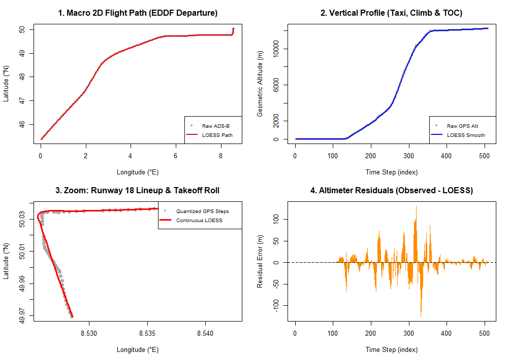

# smooth-operator
Smoothing out messy flight telemetry with non-parametric statistics.

# Non-Parametric Flight Trajectory Reconstruction & ADS-B Signal Filtering ✈️📈

**Research Context:** Developed as an extension of my L3 Statistical Modeling work at the *Laboratoire de Mathématiques et Applications (LMA - UMR CNRS 7348)*, Université de Poitiers.

## 🎯 Overview
Raw aircraft surveillance feeds (ADS-B, radar tracks, barometric/geometric altimeters) suffer from sensor noise, irregular transmission intervals, and GPS quantization steps. Rigid parametric models (e.g., global polynomial regression) fail to capture complex operational maneuvers—such as runway lineups, step-climbs, and ATC holding patterns—without introducing severe boundary oscillations (Runge's phenomenon).

This repository implements **non-parametric Kernel Density Estimation (KDE)** and **Locally Estimated Scatterplot Smoothing (LOESS)** in `R` to reconstruct continuous 3D aircraft trajectories from noisy telemetry, moving from controlled synthetic benchmarks to real commercial flight data.

---

## 📊 Real-World Validation: Lufthansa A320neo (`D-AIJB`) Departure
Using raw KML telemetry exported from ADS-B Exchange (Frankfurt `EDDF` departure to cruise at FL400 / $12,214\text{ m}$), the pipeline parses unstructured XML coordinate vectors (`<gx:coord>`) and applies decoupled local polynomial regression:

$$\hat{x}(t) = \text{LOESS}(\text{lon}_t \,\vert{}\, s = 0.12), \quad \hat{y}(t) = \text{LOESS}(\text{lat}_t \,\vert{}\, s = 0.12), \quad \hat{z}(t) = \text{LOESS}(\text{alt}_t \,\vert{}\, s = 0.12)$$

### Key Analytical Findings:
1. **Macro Trajectory & Top-of-Climb (Panels 1 & 2):** Captures the sharp transition from steep climb to level cruise at Time Step 365 ($12,000\text{ m}$) without parametric overshoot.
2. **Micro-Scale Runway Turn Reconstruction (Panel 3):** Zooming into Frankfurt Runway 18 (`Startbahn West`, Steps 90–165) demonstrates how LOESS bridges discrete, quantized GPS position jumps during the $90^\circ$ taxiway-to-runway lineup and takeoff roll.
3. **Residual Regime Diagnostics (Panel 4):** The residual distribution ($e_t = z_t - \hat{z}_t$) clearly separates three operational regimes:
   - **Surface Taxi (Steps 1–135):** Zero variance on ground baseline.
   - **Dynamic Climb (Steps 136–365):** Local curvature bias spikes at high-$\frac{d^2z}{dt^2}$ pitch transitions and irregular ADS-B packet intervals.
   - **Cruise Phase (Steps 370–509):** Stationary residual band ($\pm 15\text{ m}$) isolating pure GPS sensor jitter.

---

## 📂 Repository Contents
- `code_stage_l3.R` — Controlled mathematical simulations:
  - Bandwidth scaling & sample size sensitivity (CDG vs. Poitiers airport delay KDE)
  - 1D altimeter signal denoising & bimodal ATC holding pattern modeling
  - 2D radar approach decoupling & empirical demonstration of the Curse of Dimensionality ($d = 1 \dots 10$)
- `real_adsb_loess_analysis.R` — Custom base-R XML/KML parser and 4-panel diagnostic suite for real ADS-B telemetry.
- `track.kml` — Raw geometric altitude and 2D positional telemetry (509 state vectors).
